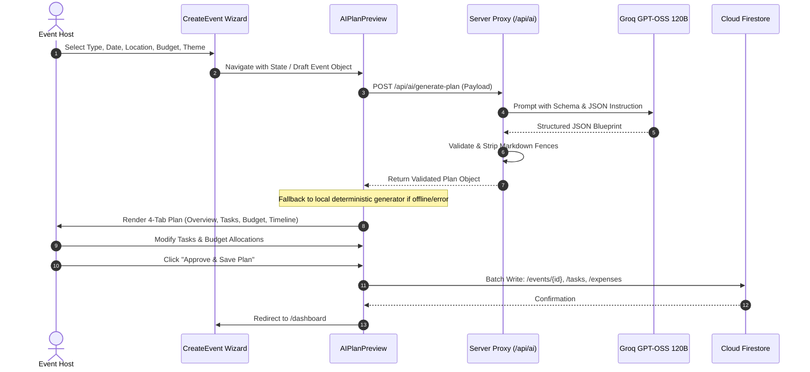
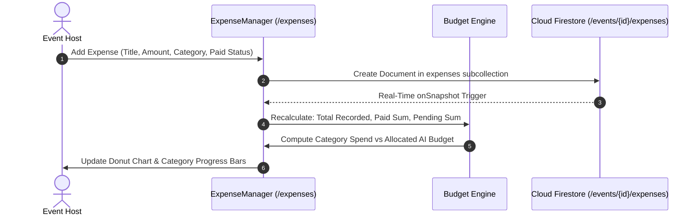
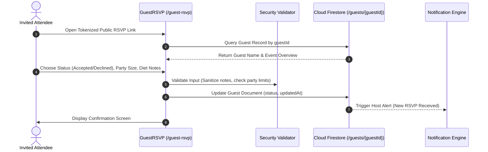
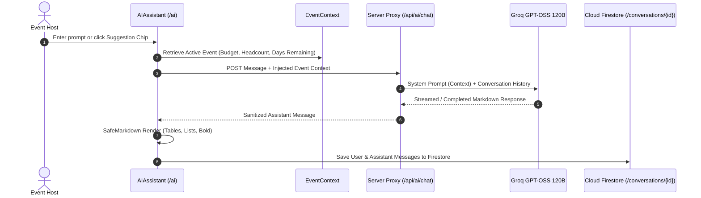

# CelebrAI — System Architecture & Technical Specifications

**Document Version:** 2.0.0  
**Status:** Verified Against Repository Implementation  
**Last Updated:** October 2026  
**Primary Engine:** React 19 + TypeScript + Cloud Firestore + Groq GPT-OSS 120B  

---

## 1. Architectural Overview

CelebrAI is structured as a modern, decoupled single-page application (SPA) backed by cloud microservices and serverless AI proxy execution:

```
┌─────────────────────────────────────────────────────────────────────────┐
│                             CLIENT WORKSPACE                            │
│                                                                         │
│   ┌─────────────────────────────────────────────────────────────────┐   │
│   │                 React 19.3.1 (Vite 8.3.5 / Rollup)              │   │
│   │                                                                 │   │
│   │   Global Contexts:                                              │   │
│   │   ├── AuthContext: User session, Firebase token, role caching  │   │
│   │   └── EventContext: Active event switching, Firestore sync      │   │
│   │                                                                 │   │
│   │   Routing & Navigation:                                         │   │
│   │   ├── React Router DOM v7 (36 feature routes + error boundary)  │   │
│   │   └── QuickDirectoryDrawer (Universal instant route navigator)  │   │
│   │                                                                 │   │
│   │   Client Storage Engines:                                       │   │
│   │   ├── IndexedDB (`celebrai_avatars`): Zero-latency binary cache │   │
│   │   └── HTML5 Canvas: Base64 client-side image compression        │   │
│   └─────────────────┬───────────────────────────────┬───────────────┘   │
└─────────────────────│───────────────────────────────│───────────────────┘
                      │                               │
                      │ HTTPS POST                    │ Real-time Firestore SDK
                      │ /api/ai/*                     │ (WebChannel / gRPC)
                      ▼                               ▼
       ┌──────────────────────────────┐ ┌──────────────────────────────┐
       │   SECURE SERVER PROXY        │ │   GOOGLE FIREBASE SUITE      │
       │   (Express / Netlify Func)   │ │   Project: `celebrai-62487`  │
       │                              │ │                              │
       │ • Request Schema Validation  │ │ • Firebase Authentication    │
       │ • Server-Side Secret Access  │ │   (Email/Pass + Google OAuth)│
       │ • Groq Cloud SDK Client      │ │ • Cloud Firestore Database   │
       │ • Regex JSON Sanitizer       │ │   (Row-Level Security Rules) │
       │ • Rate Limit & Error Fallback│ │ • Cloud Storage (Avatars)    │
       └──────────────┬───────────────┘ └──────────────────────────────┘
                      │
                      │ HTTPS POST (TLS 1.3)
                      ▼
       ┌──────────────────────────────┐
       │     GROQ INFERENCE CLOUD     │
       │                              │
       │ Model: openai/gpt-oss-120b   │
       │ Hardware: Groq LPU Inferences│
       │ Output: Strict JSON Schema   │
       │ Response Latency: <1.5s      │
       └──────────────────────────────┘
```

---

## 2. Directory & Component Architecture

CelebrAI organizes its 36 core pages and supporting libraries into distinct functional tiers:

```
src/
├── main.tsx                           # Application entry point & React 19 root
├── App.tsx                            # Router configuration & 36-page quick drawer
│
├── components/
│   ├── common/
│   │   ├── ErrorBoundary.tsx          # Production runtime crash trap
│   │   ├── FirebaseConfigBanner.tsx   # Live connection status notifier
│   │   ├── SafeMarkdown.tsx           # Multi-pass XSS-neutralized markdown renderer
│   │   └── SafeMarkdown.css           # Typography styles for AI generated content
│   └── layout/
│       ├── AppHeader.tsx              # Universal desktop & mobile navigation header
│       ├── AppHeader.css              # Editorial glassmorphic styling
│       └── AppShell.tsx               # Workspace shell with dynamic mobile bottom nav
│
├── contexts/
│   ├── AuthContext.tsx                # Multi-provider Firebase Auth observer
│   └── EventContext.tsx               # Active event state machine & Firestore listener
│
├── pages/
│   ├── public/                        # Landing (`/`), Explore (`/explore-events`)
│   ├── auth/                          # Sign In / Sign Up (`/signin`, `/signup`)
│   ├── onboarding/                    # Onboarding (`/onboarding`), Create Event (`/create-event`), Plan (`/ai-plan-preview`)
│   ├── dashboard/                     # Home (`/dashboard`), Events (`/events`), Overview (`/event-overview`), AI Mentor (`/ai`)
│   ├── planning/                      # Tasks (`/tasks`), Timeline (`/timeline`), Budget (`/budget`), Expenses (`/expenses`),
│   │                                  # Guests (`/guests`), RSVP (`/invitations`), Vendors (`/vendors`), Decor (`/decor`), Content (`/content-studio`)
│   ├── workspace/                     # Saved (`/saved`), Run Sheet (`/run-sheet`), Team (`/team`), Reports (`/reports`),
│   │                                  # Profile (`/profile`), Settings (`/settings`), Help (`/help`), Privacy (`/privacy`)
│   └── advanced/                      # Public Event (`/public-event`), Guest RSVP (`/guest-rsvp`), Collaboration (`/collaboration`),
│                                      # Notifications (`/notifications`), Subscription (`/subscription`), Admin (`/admin`)
│
├── services/
│   ├── ai/
│   │   └── groq.ts                    # Server proxy interface & prompt templates
│   ├── firebase/
│   │   ├── auth.ts                    # Sign in/up, Google OAuth popup, password reset
│   │   ├── config.ts                  # Firebase app initialization with Vite env fallback
│   │   ├── firestore.ts               # CRUD wrappers for events, tasks, guests, expenses
│   │   └── storage.ts                 # Storage reference handler with Base64 fallback
│   ├── notifications/
│   │   └── notificationEngine.ts      # Automated task & overdue alert generation
│   └── storage/
│       └── indexedDBAvatar.ts         # High-speed client-side profile photo cache
│
├── types/
│   └── index.ts                       # Master TypeScript schema definitions (0 `any` types)
└── utils/
    ├── dateUtils.ts                   # Date calculations, countdowns, ISO transforms
    ├── imageCompressor.ts             # HTML5 Canvas client-side compressor (<100 KB)
    ├── security.ts                    # XSS stripping, MIME checking, string sanitization
    ├── taskCalculations.ts            # Task progress counters & status categorizers
    └── validation.ts                  # Form input regex & boundary validators
```

---

## 3. End-to-End Data Lifecycles

### A. Event Creation & AI Plan Generation Lifecycle



---

### B. Expense & Budget Accounting Lifecycle



---

### C. Public Guest RSVP Lifecycle



---

### D. AI Mentor Context-Aware Conversation Lifecycle



---

## 4. Offline & Cache Architecture

```
                  Local Photo Upload (User Avatar)
                                 │
                                 ▼
                     ┌───────────────────────┐
                     │  HTML5 Canvas Reducer │
                     │  Max 512×512px, 85% Q │
                     └───────────┬───────────┘
                                 │
                                 ▼
                     ┌───────────────────────┐
                     │ IndexedDB Local Cache │
                     │  `celebrai_avatars`   │
                     │  Immediate 0ms Render │
                     └───────────┬───────────┘
                                 │
                     ┌───────────┴───────────┐
                     │ (Optional Cloud Sync) │
                     ▼                       ▼
          ┌─────────────────────┐ ┌─────────────────────┐
          │  Firebase Storage   │ │  Firestore User Doc │
          │  avatars/{uid}.jpg  │ │  avatarUrl / base64 │
          └─────────────────────┘ └─────────────────────┘
```

1. **IndexedDB Avatar Layer (`src/services/storage/indexedDBAvatar.ts`)**:
   - Stores compressed user avatars directly in the browser's IndexedDB database (`celebrai_avatars`).
   - Ensures authenticated user profile pictures render instantly upon page reload without incurring outbound network roundtrips or cloud storage egress costs.
2. **Deterministic Fallback Engine**:
   - If network connectivity is severed or the AI backend is unreachable, [`AIPlanPreview.tsx`](../src/pages/onboarding/AIPlanPreview.tsx) executes a deterministic local event blueprint algorithm, synthesizing categorized budgets and milestone checklists dynamically from user inputs.
